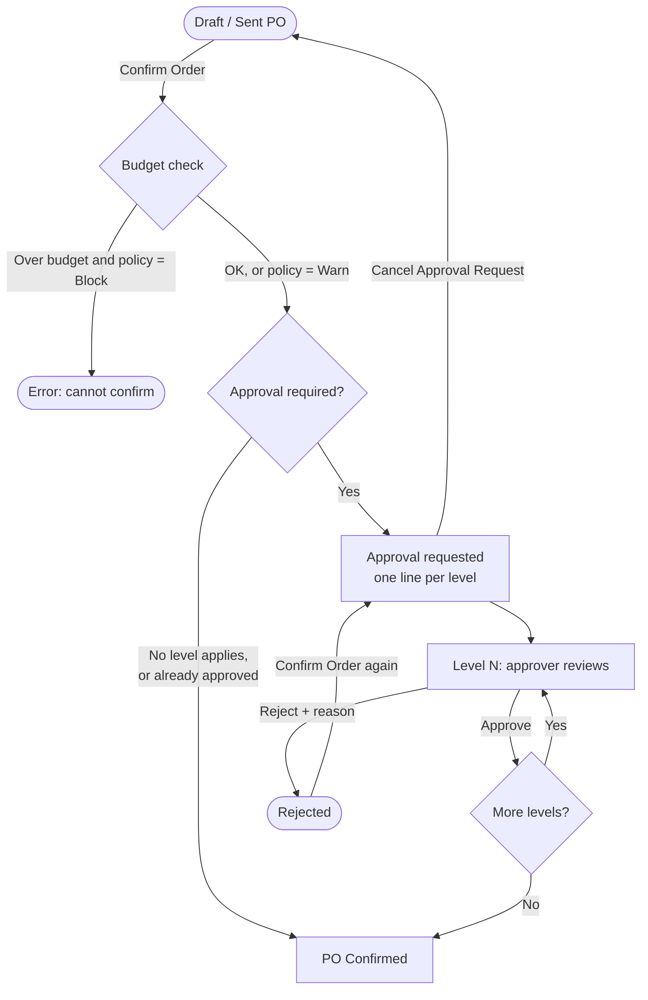
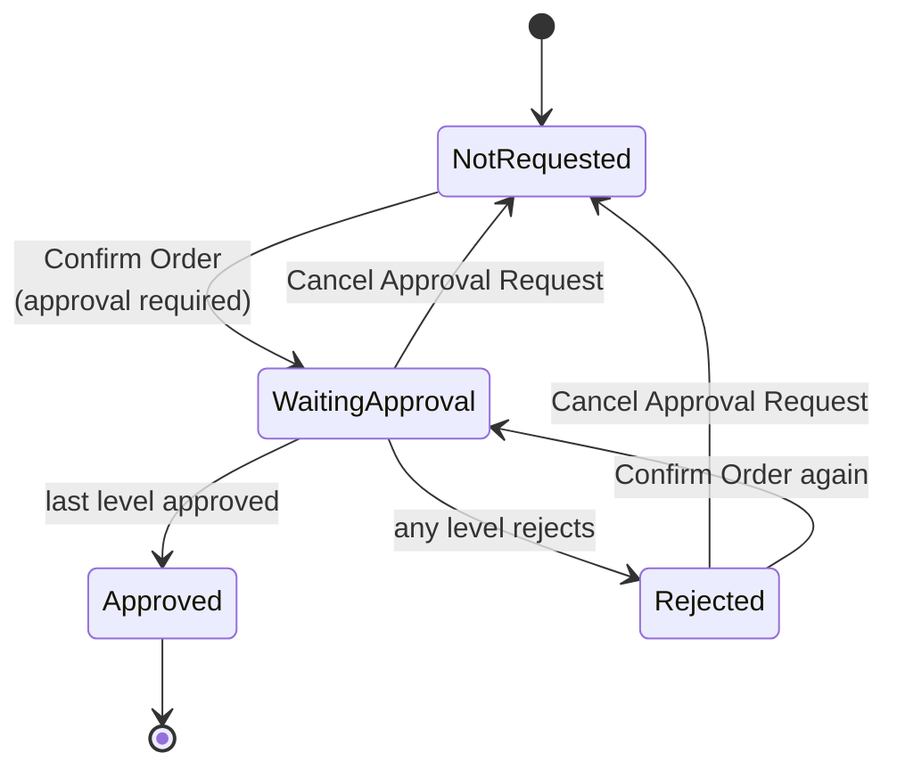
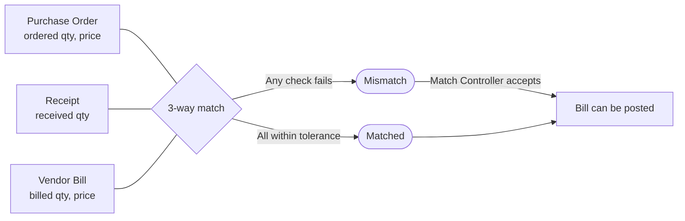
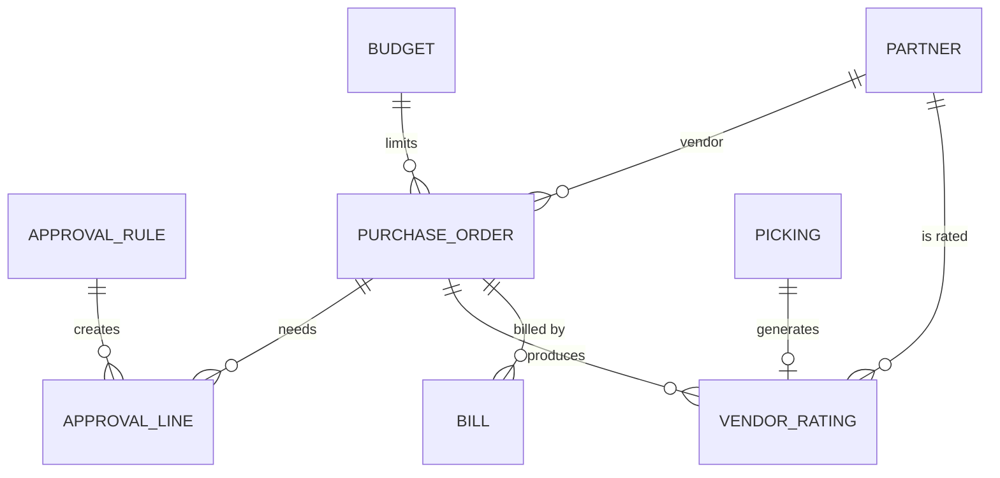

# Procurement: Purchase Approval & Vendor Management

[](https://www.odoo.com)
[](https://www.gnu.org/licenses/lgpl-3.0)

An Odoo 19 module that puts **controls around purchasing**. Purchase orders go through multi-level approval, are checked against department or project budgets, and vendors are scored automatically from their deliveries. Vendor bills are matched against the PO and the receipt (3-way match) before they can be posted.

[**[See Screenshots]**](#screenshots)

---

## Features

| Area | What you get |
|------|--------------|
| **Multi-level approval** | Configurable approval levels by amount. A PO needs approval from *every* level at or below its total, lowest level first |
| **Budget control** | Department or project (analytic) budgets with a period, a limit, and a *block* or *warn* policy |
| **Vendor rating** | A rating is created for every validated vendor receipt: on-time delivery, days late and received quality (1-5) |
| **Vendor score** | On-time %, average quality and overall score (0-5) on the vendor, plus a smart button to the ratings |
| **3-way match** | Compares PO, receipt and vendor bill on quantity and price, with configurable tolerances. Mismatched bills cannot be posted |
| **Mismatch override** | A Match Controller can accept a mismatch, with the user recorded, or revoke the acceptance |
| **Email notifications** | Approval requested, fully approved and rejected emails, sent through your default outgoing mail server |
| **Audit trail** | Every approval step, decision, user, date and rejection reason is stored and logged in the PO chatter |
| **Security** | Five independent roles, multi-company record rules, and approvers who can only act on their own steps |

---

## Workflow

### Purchase order approval



| Step | What happens |
|------|--------------|
| **Confirm Order** | The budget is checked first. Then the module looks for every approval level of the company whose *Required From Amount* is at or below the PO total (converted to company currency). |
| **No level applies** | The PO confirms normally. |
| **Approval requested** | One approval step is created per level, ordered by amount. The PO is locked in `Waiting Approval`, and the first level's approvers get an email. |
| **Approve** | Only an approver of the *current* level can approve, and never the person who requested approval. The next level is notified. |
| **Last level approved** | The PO is marked `Approved`, the requester is emailed, and the PO is **confirmed automatically**. |
| **Reject** | A wizard asks for a reason. The step and the PO become `Rejected`, and the requester is emailed. The PO can be fixed and submitted again with **Confirm Order**. |
| **Cancel Approval Request** | Removes the approval steps and returns the PO to `Not Requested` (draft orders only). |

If the PO total goes **up** after approval was requested, approving fails and the request must be cancelled and submitted again. A PO whose total is higher than the approved amount is never treated as approved.

### Approval states



### Vendor rating

A rating record is created automatically when an **incoming receipt linked to a purchase order** is validated.

| Value | How it is calculated |
|-------|----------------------|
| **Promised date** | The PO's planned date, or the receipt's scheduled date if the PO has none |
| **Days late** | Calendar days between the promised date and the done date, compared in the user's timezone so it matches what people see on screen. Never below 0 |
| **On time** | `True` when days late is 0 |
| **Delivery score** | `5` if on time, otherwise `5 − days late` (minimum 0) |
| **Quality** | Chosen by the warehouse on the receipt (*Received Quality*, 1-5) |
| **Score (0-5)** | Average of delivery score and quality. Equals the delivery score if no quality was given |

Setting or changing *Received Quality* on a receipt also updates the rating already created for it. On the vendor (commercial partner), the module keeps the rating count, on-time %, average quality and overall score. The score is also shown on the PO.

### 3-way match



The match is evaluated on vendor bills (`in_invoice`) that have lines linked to purchase order lines. A bill is flagged as **Mismatch** when any line fails one of these checks:

| Check | Fails when |
|-------|-----------|
| **Billed vs ordered** | Total billed quantity > ordered quantity + quantity tolerance |
| **Billed vs received** | For goods products, total billed quantity > received quantity + quantity tolerance |
| **Price** | Bill price differs from PO price by more than the price tolerance (%). Skipped when the bill and the PO use different currencies |

The mismatch details are listed on the bill. While **Block mismatched bills** is on, posting a mismatched bill raises an error unless a Match Controller has accepted it. Bills that are not vendor bills or have no PO-linked lines show *Not Applicable*.

---

## Roles & Security

Roles are **independent**: none of them implies another. Assign every role a user needs, and keep the standard Odoo Purchase groups for day-to-day purchasing.

| Role | Can do |
|------|--------|
| **Administrator** | Create and edit approval levels, see all approval steps. Read-only on budgets and ratings |
| **Approver** | Approve or reject POs at the levels they are assigned to. Can only change their own steps. Read-only on budgets |
| **Budget Manager** | Create and edit budgets and see all of them, including future periods |
| **Vendor Manager** | Create and correct vendor rating records |
| **Match Controller** | Accept or revoke a 3-way match mismatch on a vendor bill |
| **Purchase Manager** *(Odoo)* | Read approval levels, steps, budgets and ratings, and see the Pending Approvals menu |
| **Purchase User** *(Odoo)* | Read approval steps, budgets and ratings |

Record rules:

- All models are **multi-company** aware.
- Approvers can only modify approval steps where they are one of the approvers.
- Budget managers and administrators see every budget. Other readers only see budgets whose period has already started.
- Nobody can approve a PO they requested themselves.

An approver must be both in the **Approver** group and listed on the approval level.

### Example users for testing

A suggested set of users that covers every role. In each user's **Access Rights** tab, set the groups below and leave every other *Procurement Control* group on **No**.

| User | Login | Supply Chain / Accounting | Procurement Control |
|------|-------|---------------------------|---------------------|
| Shafin Malitha | `buyer` | Purchase: **User**<br/>Inventory: **User** (needed to validate receipts) | All **No** |
| Jawad Karim | `approver1` | Purchase: **User** | Purchase Approval: **Approver** |
| Nadir Ahsan | `approver2` | Purchase: **User** | Purchase Approval: **Approver** |
| Karim | `budgetmgr` | Purchase: **User** | Budget Control: **Budget Manager** |
| Mamun | `vendormgr` | Purchase: **User** | Vendor Rating: **Vendor Manager** |
| Sharif | `matchctl` | Purchase: **User**<br/>Accounting: **Billing** | 3-Way Match: **Match Controller** |
| Administrator | *(your own user)* | Unchanged | Procurement Configuration: **Administrator** |

Notes:

- The buyer creates and confirms purchase orders and validates receipts, but cannot approve anything.
- `approver1` and `approver2` must also be added as approvers on the approval levels (for example Level 1 → `approver1`, Level 2 → `approver2`).
- Give every user an email address, otherwise approval emails are not sent.

---

## Configuration

### 1. Approval levels

**Purchase → Approval & Vendor Control → Approval Levels**

| Field | Meaning |
|-------|---------|
| Level Name | Shown on the PO approval tab and in emails |
| Required From Amount | The level is required when the PO total (company currency) is at or above this amount |
| Approvers | Internal users who may approve this level |

Example: *Manager* from 1,000 and *Director* from 10,000. A PO of 5,000 needs only the Manager. A PO of 20,000 needs the Manager first, then the Director.

### 2. Budgets

**Purchase → Approval & Vendor Control → Budgets**

| Field | Meaning |
|-------|---------|
| Type | *Department* or *Project* (analytic account) |
| Period | Date range the budget is valid for. The PO date must fall inside it |
| Budget Limit | Maximum committed amount |
| When Exceeded | *Block confirmation* or *Warn only* (message in the PO chatter) |

Committed amount is the total of confirmed and done POs linked to the budget. Pick the budget on the PO's **Approval & Budget** tab.

### 3. System parameters

**Settings → Technical → System Parameters** (developer mode)

| Key | Default | Meaning |
|-----|---------|---------|
| `procurement_approval.price_tolerance` | `0` | Allowed bill vs PO price difference, in % |
| `procurement_approval.qty_tolerance` | `0` | Allowed extra quantity (units) over ordered / received |
| `procurement_approval.block_mismatch` | `True` | Block posting of mismatched bills. Set to anything else to allow posting |

### 4. Email

Notifications are sent from the user who triggers the action, through the **default outgoing mail server**. Recipients need an email address on their partner record. Templates are under **Settings → Technical → Email Templates** (*Purchase Approval: Request / Approved / Rejected*).

### 5. Menus

Everything is under **Purchase → Approval & Vendor Control**:

| Menu | Visible to |
|------|-----------|
| Pending Approvals | Approver, Administrator, Purchase Manager |
| Budgets | Budget Manager, Administrator, Approver |
| Vendor Ratings | Vendor Manager, Administrator, Purchase Manager |
| Mismatched Bills | Match Controller, Administrator |
| Approval Levels | Administrator |

---

## Installation

### Requirements

- Odoo **19.0**
- Odoo apps: `purchase`, `purchase_stock`, `stock`, `account`, `hr`, `mail`

### Steps

```bash
# 1. Clone into your custom addons directory
git clone https://github.com/TanvirAhmedCSE/procurement_approval.git /path/to/custom_addons/procurement_approval

# 2. Add the directory to addons_path in odoo.conf
#    addons_path = /opt/odoo/addons,/path/to/custom_addons

# 3. Restart Odoo and install
./odoo-bin -c odoo.conf -d <your_db> -i procurement_approval
```

Or: **Apps → Update Apps List → search "Procurement" → Install**.

---

## Module Structure

```
procurement_approval/
├── __init__.py
├── __manifest__.py
├── data/
│   ├── config_data.xml          # Tolerance & blocking system parameters
│   └── mail_template_data.xml   # Request, approved, rejected emails
├── models/
│   ├── approval_rule.py         # Approval levels + PO approval steps
│   ├── budget.py                # Department / project budgets
│   ├── vendor_rating.py         # One rating per validated receipt
│   ├── res_partner.py           # Vendor score fields
│   ├── purchase_order.py        # Approval flow, budget check, confirm override
│   ├── stock_picking.py         # Received quality, rating creation
│   └── account_move.py          # 3-way match and override
├── wizard/
│   ├── reject_wizard.py         # Rejection reason
│   └── reject_wizard_views.xml
├── security/
│   ├── security.xml             # Groups & record rules
│   └── ir.model.access.csv
└── views/
    ├── approval_rule_views.xml
    ├── budget_views.xml
    ├── vendor_rating_views.xml
    ├── purchase_order_views.xml
    ├── stock_picking_views.xml
    ├── account_move_views.xml
    ├── res_partner_views.xml
    └── menus.xml
```

---

## Data Model



| Model | Purpose |
|-------|---------|
| `procurement.approval.rule` | An approval level: amount threshold and approvers |
| `purchase.approval.line` | One approval step on a PO: state, decider, date, reason |
| `procurement.budget` | A department or project budget for a period |
| `vendor.rating` | One delivery and quality rating per validated receipt |
| `procurement.reject.wizard` | Collects the rejection reason |

Extended standard models: `purchase.order`, `stock.picking`, `account.move`, `res.partner`.

---

## Screenshots


---

## Notes

- Approval amounts are compared in the **company currency**, converted at the PO date.
- The budget counts only **confirmed and done** POs. Draft orders are not committed.
- A budget is checked when the PO is confirmed, and again when approval is completed and the PO confirms itself.
- Each validated receipt gets one rating, so partial deliveries are rated separately.
- Price checks in the 3-way match are skipped when the bill currency differs from the PO currency.
- Accepting a mismatch records who accepted it and posts a note in the bill chatter.

---

## License

Distributed under the **LGPL-3** license.
